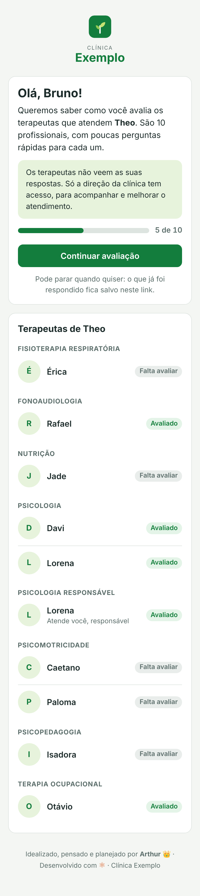
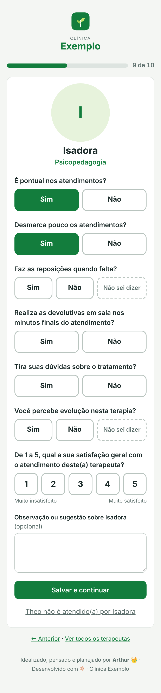
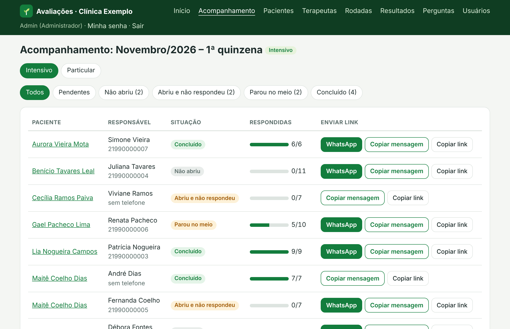
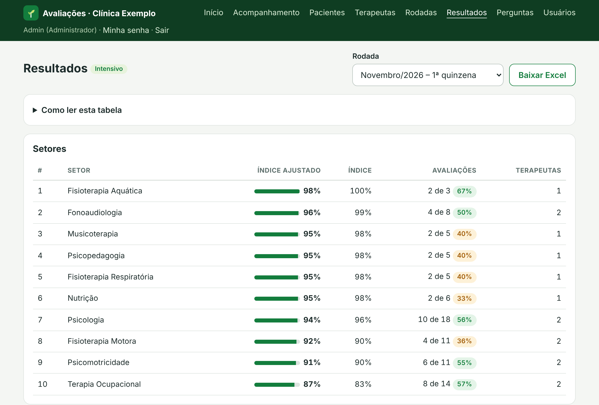
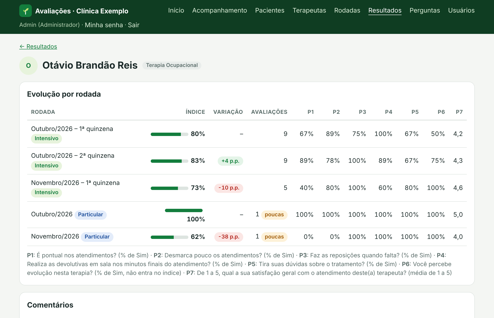
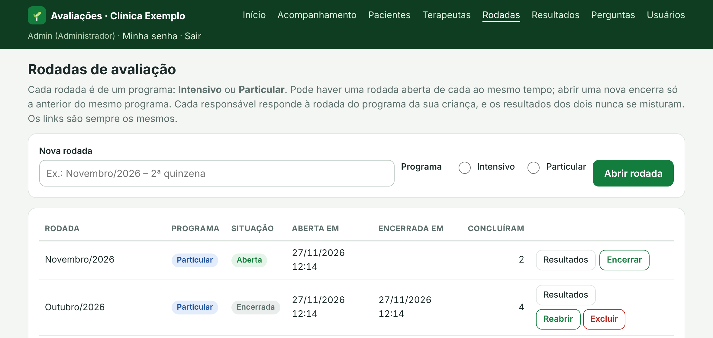
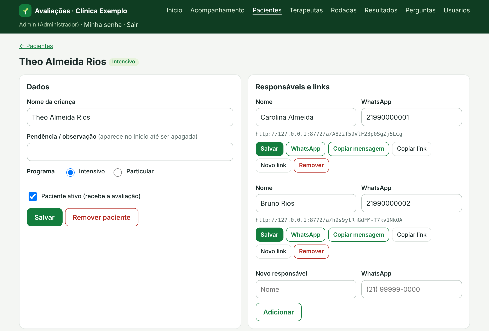

# Avaliação dos Terapeutas

Sistema web em que os responsáveis pelos pacientes de uma clínica multidisciplinar avaliam, a cada quinzena,
os terapeutas que atendem seus filhos. Cada responsável recebe **um link pessoal** e vê **somente os
profissionais que atendem a sua criança**; a direção acompanha o desempenho por terapeuta e por setor.

> Este repositório é a versão de demonstração: mesmo código do sistema em uso, com marca genérica e
> **dados 100% fictícios**.

| Responsável (celular) | Avaliação de um terapeuta |
|---|---|
|  |  |

## O problema

A clínica atende crianças em regime intensivo: cada uma tem um cronograma próprio, com cerca de 14 terapeutas
diferentes. A pesquisa de satisfação era feita no Google Forms e nenhum formato funcionava:

- **Um formulário por terapeuta:** cada família recebia mais de dez links. Os pais se perdiam, a recepção
  também, e consolidar as respostas era manual.
- **Um formulário por terapia, com todos os profissionais do setor:** os pais avaliavam só os primeiros da
  lista, ou avaliavam quem não atendia o filho.

O formulário não sabia quem estava respondendo, então o trabalho de filtrar ficava com os pais.

## A solução

- **Link único por responsável**, enviado pelo WhatsApp, sem login nem senha.
- A página mostra só os terapeutas daquela criança, com **foto e nome**, agrupados por terapia.
- **Um terapeuta por tela**, com barra de progresso. O que foi respondido fica salvo: dá para parar e
  continuar depois pelo mesmo link.
- Perguntas de Sim/Não, nota de 1 a 5 ou texto, **editáveis pelo painel**. Opção "Não sei dizer" por pergunta.
- Atendimentos voltados ao responsável (ex.: Psicologia Responsável) são sinalizados e avaliados à parte.
- Botão "meu filho não é atendido por este profissional": não conta como nota e avisa a recepção de que o
  cronograma pode estar desatualizado.
- Pacientes separados em dois **programas** (Intensivo e Particular), com rodadas, acompanhamento e
  resultados próprios: cada responsável cai na rodada do programa da sua criança e os números nunca se misturam.

### Painel interno, com três perfis

| Perfil | O que faz |
|---|---|
| **Recepção** | Cadastra pacientes, responsáveis e terapeutas; abre e encerra rodadas; envia os links; vê quem ainda não respondeu. Não vê notas. |
| **Direção** | Tudo da recepção, mais as perguntas, os resultados e a exportação para Excel. |
| **Administrador** | Tudo, mais a gestão de usuários e a exclusão de rodadas encerradas (ex.: rodadas de teste). |



**Acompanhamento:** quem concluiu, quem parou no meio e quem nem abriu o link, com botão de WhatsApp e
mensagem pronta para cobrar.



**Resultados:** por terapeuta e por setor, quantas crianças cada um atende, quantas avaliações recebeu de
quantas deveria receber (cobertura), o índice de respostas positivas e um **índice ajustado pela cobertura**,
além do percentual de "Sim" em cada pergunta, comentários e exportação para Excel (incluindo quem não respondeu).

O índice ajustado resolve um problema real da pesquisa: um terapeuta com 3 avaliações pode ter recebido todas
as que devia (atende 3 crianças) ou só um quarto delas (atende 12). O ajuste mistura o índice dele com a média
geral na proporção do que faltou:

```
índice ajustado = cobertura × índice do terapeuta + (1 − cobertura) × média geral da rodada
```

Com 12 de 12 respostas ele é igual ao índice; com 3 de 12, vale 25% o índice e 75% a média. Assim, poucas
respostas não colocam ninguém no topo nem no fim do ranking.



**Evolução:** histórico de cada terapeuta rodada a rodada, com variação e comentários.



**Rodadas:** cada uma é de um programa; pode haver uma aberta de cada ao mesmo tempo.



**Cadastro:** responsáveis com seus links e a lista de terapeutas de cada criança. Quando o cronograma muda,
basta ajustar a lista: o link do responsável continua o mesmo.

Outros recursos: importação por planilha, envio de fotos em lote, lista de pendências de cadastro,
terapeuta que atua em mais de um setor pontuando separadamente em cada um.

## Tecnologia

- **Python 3.12**, **FastAPI**, **SQLAlchemy 2**, templates **Jinja2** renderizados no servidor
- **PostgreSQL** em produção (SQLite para rodar localmente)
- HTML e CSS próprios, sem framework de front-end; pensado primeiro para celular
- Deploy no **Railway** a partir do GitHub

Mudanças de estrutura no banco são aplicadas sozinhas na subida (lista `MIGRACOES` em `app/main.py`), sem
apagar dados, já que o sistema está em uso.

Cuidados com os dados: links com código aleatório por responsável, senhas com PBKDF2, perfis de acesso
separados, páginas fora dos buscadores e apenas o mínimo de dados pessoais (sem diagnóstico ou prontuário).

## Rodar a demonstração

```
python -m venv .venv
.venv\Scripts\activate          # Linux/macOS: source .venv/bin/activate
pip install -r requirements.txt
set DEMO=1                      # Linux/macOS: export DEMO=1
uvicorn app.main:app --reload
```

Abra http://127.0.0.1:8000 e entre com `admin`, `direcao` ou `recepcao` (senha `demo1234`).
Em **Acompanhamento** você copia o link de um responsável para ver a tela dos pais.

`DEMO=1` carrega pacientes dos dois programas, terapeutas e rodadas com respostas sorteadas. Não use em produção.

## Publicar

1. Crie um projeto no Railway a partir do repositório e adicione um banco PostgreSQL.
2. Configure as variáveis de `.env.example` no serviço (`DATABASE_URL`, `SECRET_KEY`, `ADMIN_USER`,
   `ADMIN_PASSWORD`, `HTTPS_ONLY=1`, `CLINIC_NAME`).
3. Gere o domínio. As tabelas são criadas na primeira subida.

## Estrutura

```
app/main.py           inicialização, sessão e dados iniciais
app/models.py         tabelas
app/routes_public.py  páginas do responsável (/a/<código>)
app/routes_admin.py   painel (/painel/...)
app/stats.py          andamento da rodada, pendências e cálculo dos índices
app/demo.py           dados fictícios da demonstração
app/templates/        telas
app/static/           estilo e imagens
```

## Créditos

Idealizado, pensado e planejado por **Arthur Manhães**, a partir de uma necessidade real da clínica onde
trabalha. Desenvolvido com o Claude.
